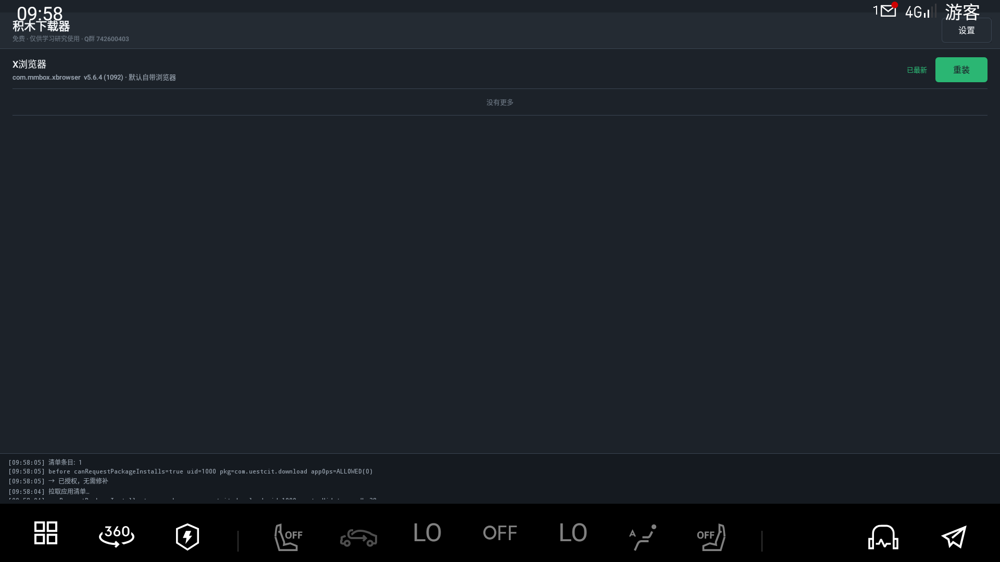
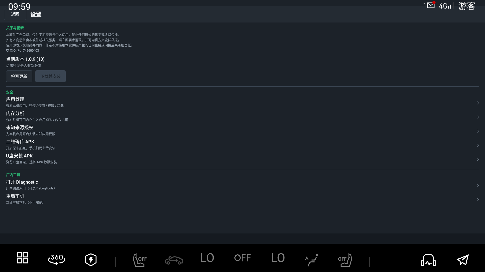
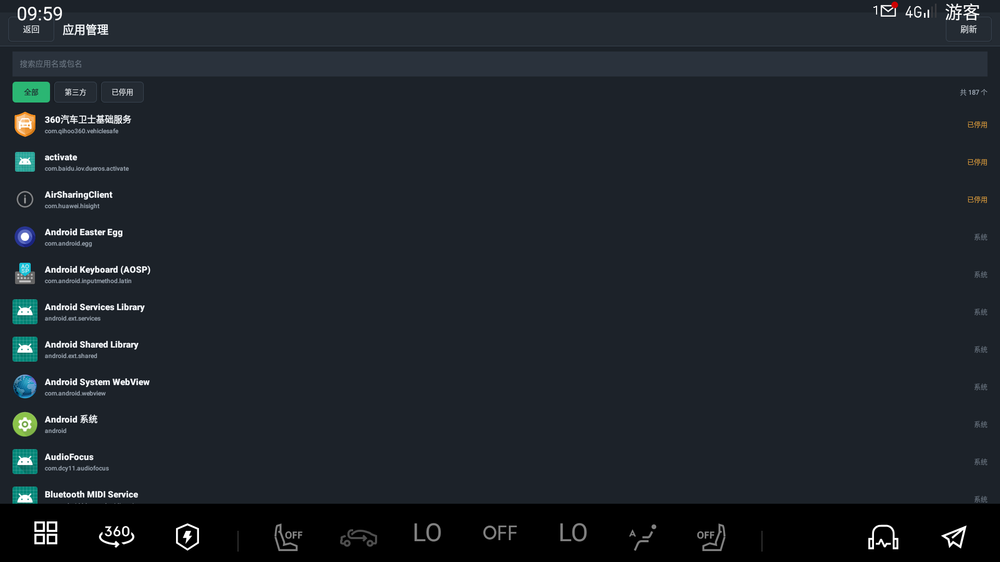
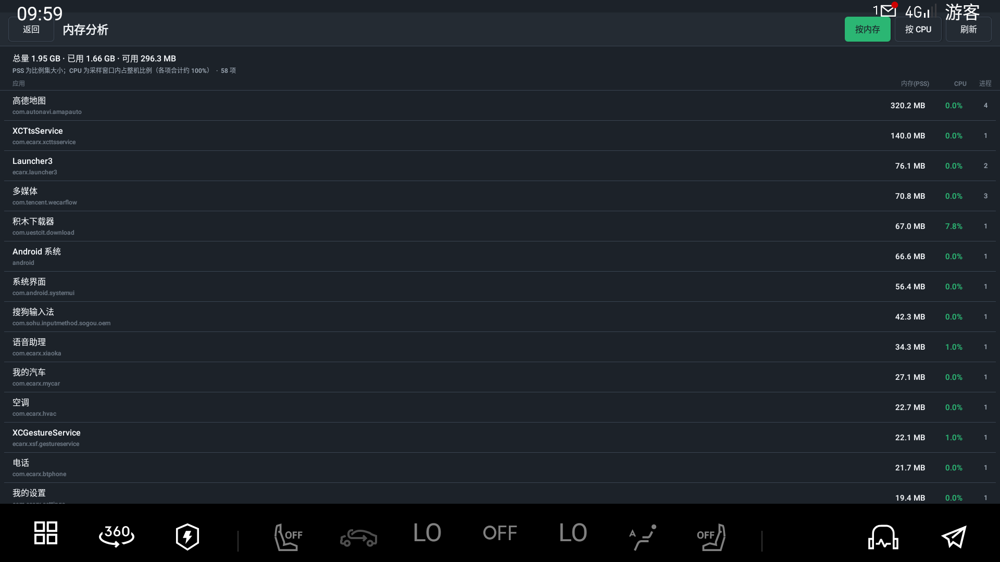

# 积木下载器（com.uestcit.download）

面向车机的应用下载与安装工具：从服务端清单拉取 APK、本包自更新、管理本机应用，并在具备系统签名权限时支持静默安装与「安装未知应用」授权。

## 功能

| 功能 | 说明 |
|------|------|
| 应用列表 | 拉取服务端 `apps.json`，下载并安装 |
| 自更新 | 拉取服务端 `download/latest.json`，提示升级本包 |
| 应用管理 | 已装应用列表与详情：强停 / 停用·启用 / 清缓存 / 清数据 |
| 未知来源 | 为可声明安装权限的应用开关「允许安装未知应用」 |
| 设置页承接 | 可承接系统「管理未知应用来源」相关入口 |
| 二维码传 APK | 本机开启热点 + HTTP 接收，手机扫码上传后安装 |
| U 盘安装 | 浏览可移动存储中的 APK 并安装 |
| 静默安装 | 优先 `PackageInstaller` 会话；失败时回退系统安装界面 |

**运行前提：** 完整能力依赖系统平台签名与 `sharedUserId=android.uid.system`（系统 UID）。普通调试签名下可编译运行，但静默安装 / 未知来源等系统级能力会受限或不可用。

## 截图

| | |
|--|--|
|  |  |
|  |  |

更多见 [`docs/screenshots/`](docs/screenshots/)。

## 构建

依赖：`libs/ecarx.adapterapi.jar`（`compileOnly`，见 [`libs/README.md`](libs/README.md)）。

```powershell
.\gradlew.bat assembleDebug
# 产物：app\build\outputs\apk\debug\app-debug.apk
```

需要系统级能力时，请使用与目标车机固件一致的 **AOSP test platform**（或该固件实际平台）证书对 APK 重签后再安装。

## 服务端约定

下载器通过可配置的 Base URL 访问两类静态清单（字段示例见仓库 `docs/`）：

| 资源 | 用途 |
|------|------|
| `{base}/apps/apps.json` | 可安装应用列表与 APK 地址 |
| `{base}/download/latest.json` | 本包自更新（`versionName` / `versionCode` / `apk` / `whatsNew`） |

`apk` 可为相对文件名或绝对 `http(s)` URL。示例：[`docs/apps.json.example`](docs/apps.json.example)、[`docs/latest.json.example`](docs/latest.json.example)。

## 静默安装说明

主路径创建 `PackageInstaller` 会话，并尽量关闭用户确认后等待终态；结果以对话框展示成功或 `INSTALL_*` 失败码。  
若系统仍要求用户确认，会拉起确认界面并继续等待；静默路径失败时回退到系统包安装器 UI。

## License

以仓库内声明为准；未单独声明时默认保留所有权利，仅供学习与适配参考。
